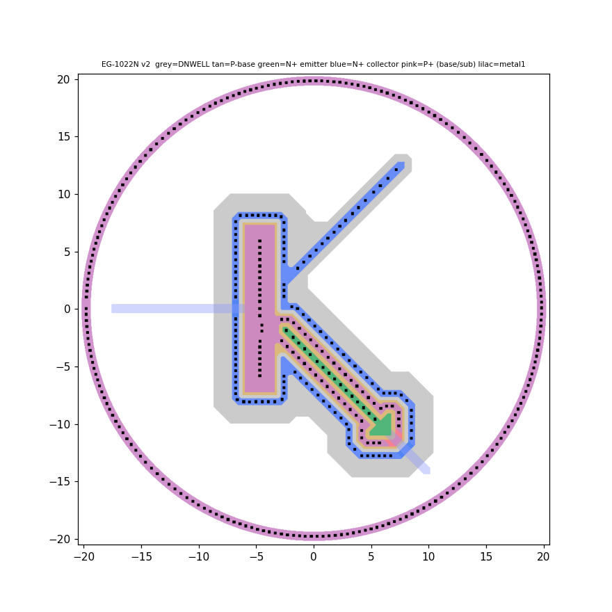
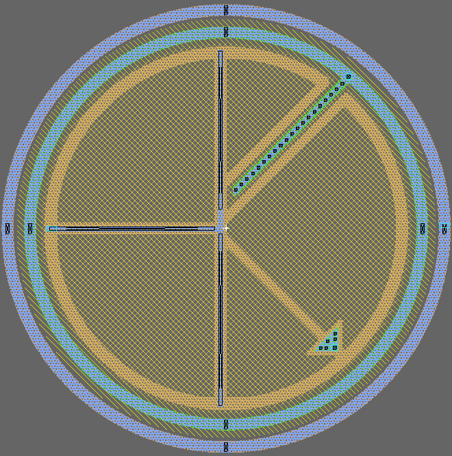
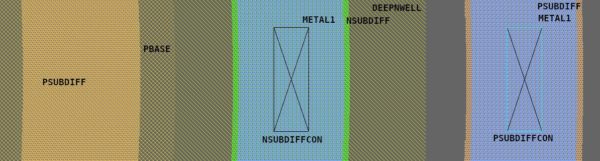
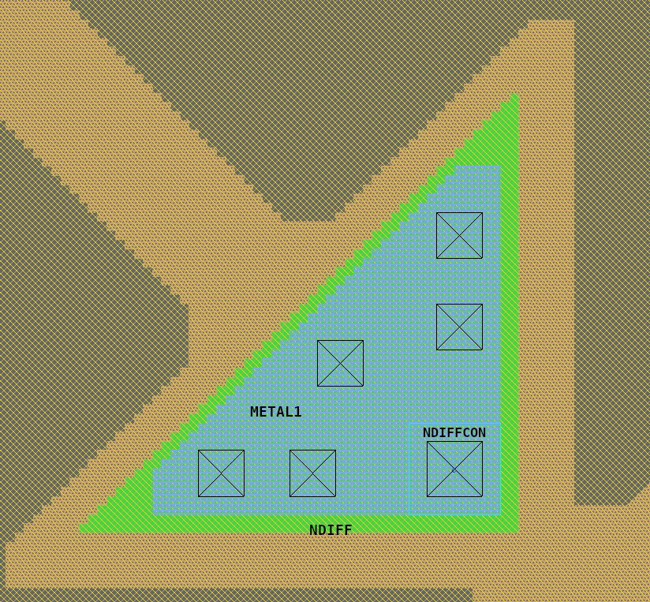

# EG-1022N (Magic VLSI)
A BJT NPN transistor, whose layout resembles its electronics symbol. Made in Magic using the GlobalFoundries GF180MCU PDK.

## V2 layout



V2 is a vertical NPN (N+ emitter / P-well base / deep N-well collector) where every stroke of the
symbol is a working part of the device:

| Symbol stroke | Layout |
|---|---|
| Base bar | P-base (P-well in deep N-well) with P+ base contact |
| Emitter line + arrowhead | 0.54 um N+ emitter stripe and arrowhead (same width as the stock `npn_00p54x*` cells), with P+ base contacts along both sides |
| Collector line | N+ collector stripe in deep N-well, plus an N+ collector outline around the base strokes |
| Circle | P+ substrate guard ring |
| Base / emitter leads | Metal1 |

The P-base sits only under the strokes, not under a filled disc, which keeps the junction
capacitances small. All diagonal edges are true 45-degree geometry (Magic split tiles), not
staircases.

The emitter area is 8.63 um2, so Magic extracts it as the stock `npn_00p54x16p00` device.

### Verification
- Magic DRC (`drc(full)`, GF180MCU deck): **0 errors**
- Netgen LVS against a single `npn_00p54x16p00`: **circuits match uniquely**

Not yet checked: the foundry KLayout DRC deck, density, and antenna rules. The deep N-well is kept
2.5 um from the substrate ring, matching the stock cells; Magic's deck does not check this spacing.

### Performance (simulated, ngspice, 27 C)

| | V2 | stock npn_00p54x16p00 |
|---|---|---|
| Peak beta | 8.1 | 7.9 |
| V_BE at 1 / 10 / 100 uA | 681 / 741 / 804 mV | 680 / 740 / 803 mV |
| V_BE temperature drift (10 uA) | -1.68 mV/K | -1.68 mV/K |
| C_BC at 0 V | 65 fF | 35 fF |
| C_CS at 0 V | 139 fF | 82 fF |
| R_B / R_C | ~160 / ~14 ohm | 137 / 13 ohm |
| fmax estimate (100 uA) | ~2.9 GHz | ~4.3 GHz |

The DC behaviour matches the stock device. The extracted netlist uses the stock model, which is fine
for LVS. For realistic simulation, use the `eg1022n_v2` subcircuit in `sim/eg1022n.lib`; it scales
C_BC, C_CS, R_B and R_C to the drawn geometry.

How the model was built: parameters are fitted by area and perimeter across the six stock NPN models
against their geometry in the PDK GDS (capacitance fits within 1%). R_B and R_C come from a 2-D
resistor-mesh solve on the layout, calibrated against the stock cells. The PDK NPN models have no
forward transit time, so fT figures are capacitance-limited upper bounds.

### Files
- `gen/gen_eg1022n.py`: parametric generator for the V2 layout (writes the `.mag` and preview image)
- `gen/EG1022N_V2.mag`, `gen/EG1022N_V2.gds`: layout
- `gen/EG1022N_V2_lvs.spice` (LVS netlist), `gen/EG1022N_V2.spice` (with parasitic capacitors)
- `gen/drc_ext.tcl`: runs DRC, extraction and GDS output in Magic
- `sim/eg1022n.lib`: geometry-scaled models (`eg1022n_v2`, plus V1 variants)
- `sim/*.py`: geometry analysis, model fitting and ngspice testbenches; `sim/*.png`: plots

Rebuild:
```sh
export PDK_ROOT=~/pdk
cd gen
python3 gen_eg1022n.py EG1022N_V2.mag
magic -dnull -noconsole -rcfile ../gf180mcuC.magicrc drc_ext.tcl EG1022N_V2
```

## V1 layout (original)





The original layout is kept in `V1/` for reference (`V1/NPN_BJT_SYMBOL_TRANSISTOR.mag`; open it from that folder with `magic -rcfile ../gf180mcuC.magicrc`). Analysis found:
- The emitter N+ is butted against the base P+ on all sides. With GF180's default salicide, this
  shorts emitter to base, so the device would not work as a transistor.
- Magic tagged the device `npn_10p00x10p00` only through the extraction rule's error fallback. The
  real emitter is 2.94 um2, so `V1/NPN_BJT_SYMBOL_TRANSISTOR.spice` does not describe it.
- Most of the diagonal collector N+ stripe sits on the P-base instead of the deep N-well, forming an
  extra base-collector diode.
- The filled P-base disc (853 um2) gives C_BC of about 343 fF. Even with the emitter gap fixed,
  fmax would be about 1 GHz.

Tools created for Magic: https://gist.github.com/ellisgl/9e310044a7b0ba08d3c0bf9d441ad0eb

## License
Copyright © 2026 Kenneth McCall (Ellis GeekLab) 
This source describes Open Hardware and is licensed under the CERN-OHL-S v2.0 or any later version.
You may redistribute and modify this source and make products using it under the terms of the CERN-OHL-S v2.0 (ohwr.org).
This source is distributed WITHOUT ANY EXPRESS OR IMPLIED WARRANTY, INCLUDING OF MERCHANTABILITY, SATISFACTORY QUALITY AND FITNESS FOR A PARTICULAR PURPOSE. Please see the CERN-OHL-S v2.0 for applicable conditions.
Source location: https://github.com/ellisgl/EG-1022N
